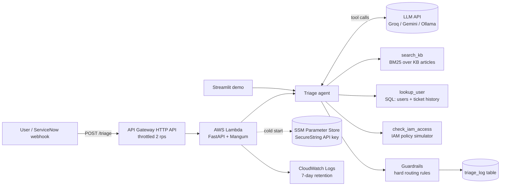

# Architecture

## Request flow

1. A ticket arrives at `POST /triage` (API Gateway, Lambda) or through the Streamlit demo.
2. The agent sends the ticket and three tool definitions to the LLM.
3. The LLM calls tools: knowledge-base search, a user and ticket-history lookup in SQL, and an AWS IAM access check. Results go back to the LLM. The loop is capped at 5 turns.
4. The LLM returns a JSON decision, validated by a Pydantic model (fixed sets of categories, priorities and teams).
5. Guardrails apply rules the model cannot override: outages are always P1 and go to incident management, security issues always go to the security team, and production write access always goes to the cloud team.
6. The decision is logged to SQL so accuracy can be reviewed and reported on.

## Components

| Component | File | Notes |
|---|---|---|
| Agent loop | `clouddesk/agent.py` | Tool calling, structured output, guardrails |
| LLM client | `clouddesk/llm.py` | One OpenAI-compatible client for Groq, Gemini and Ollama; retries on 429/5xx; offline mock |
| Tools | `clouddesk/tools.py` | Small, trimmed JSON results to stay inside free-tier token limits |
| Knowledge base | `clouddesk/kb.py`, `data/kb/` | BM25 ranking in pure Python, no vector database needed at this size |
| Database | `clouddesk/db.py`, `data/*.sql` | SQLite; users, tickets, triage log, reports with GROUP BY |
| IAM checker | `clouddesk/iam.py` | Offline snapshot or live AWS (read-only, policy simulator) |
| API | `clouddesk/api.py` | FastAPI; OpenAPI docs at `/docs` |
| Infrastructure | `infra/terraform/` | Lambda, API Gateway, IAM role, SSM, CloudWatch, AWS Budgets |
| CI | `.github/workflows/ci.yml` | Tests, eval gate, Docker build and container smoke test |
